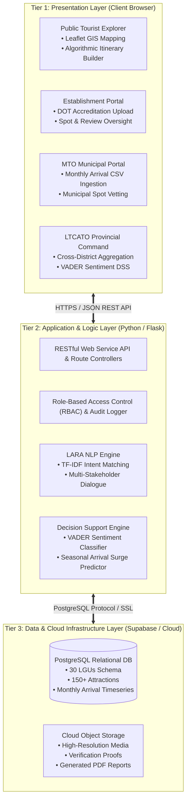
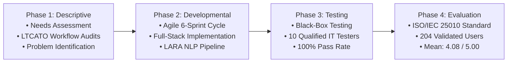
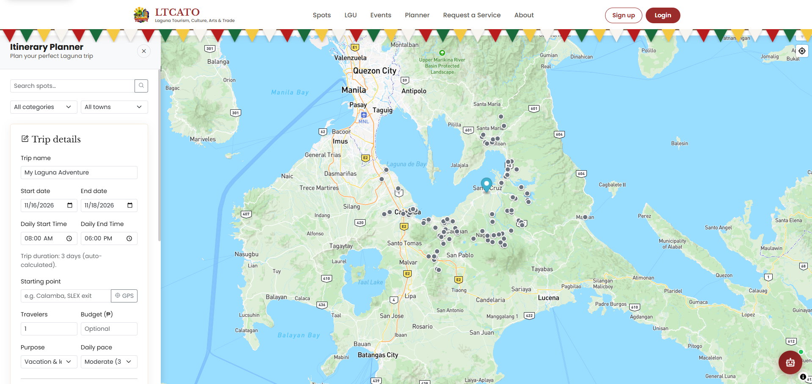
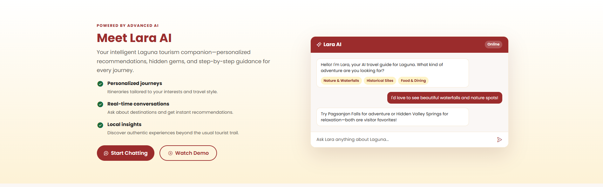
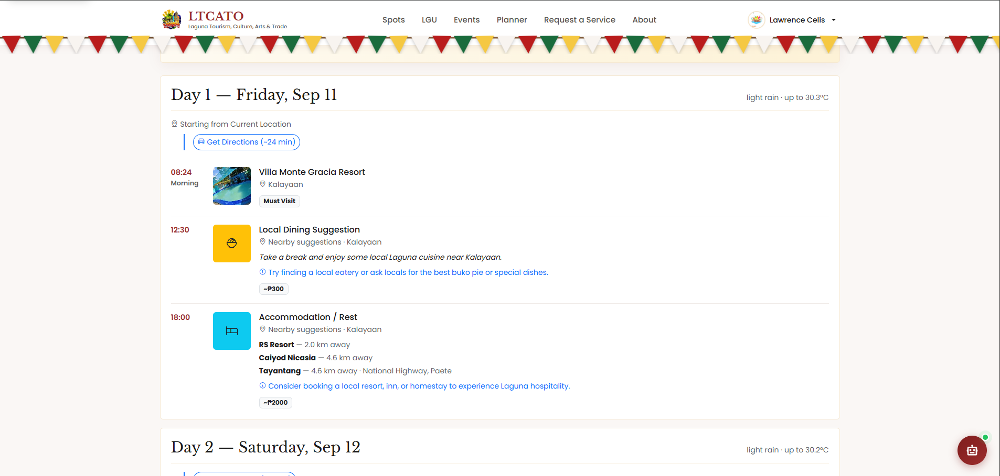
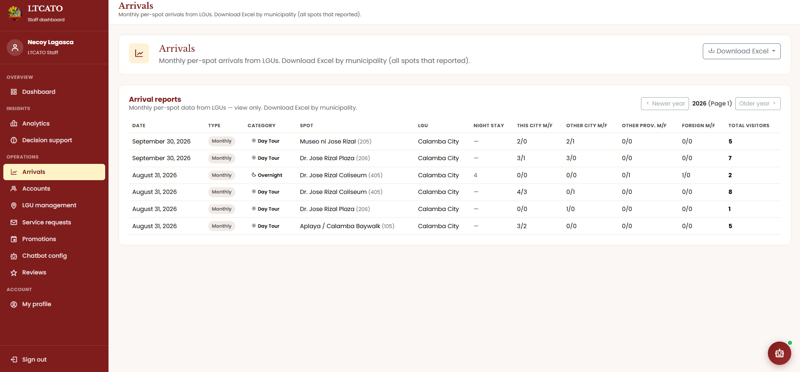
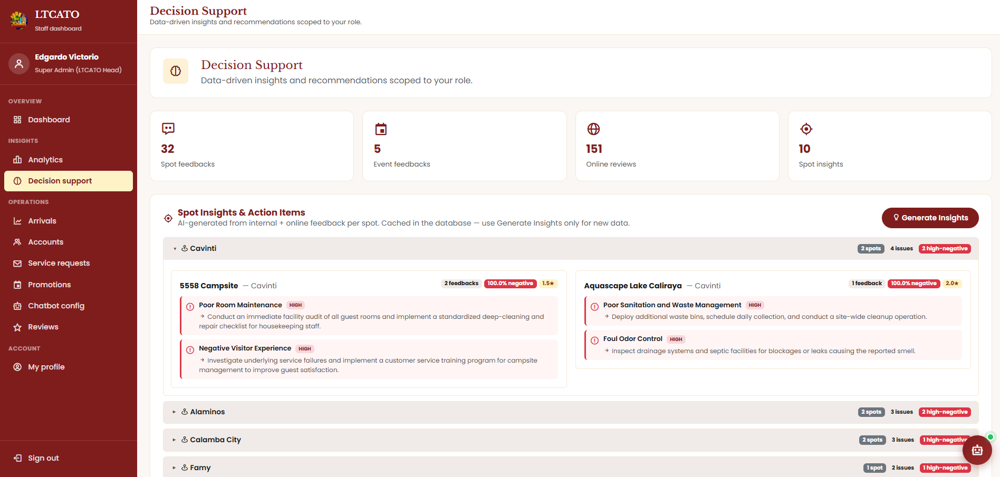
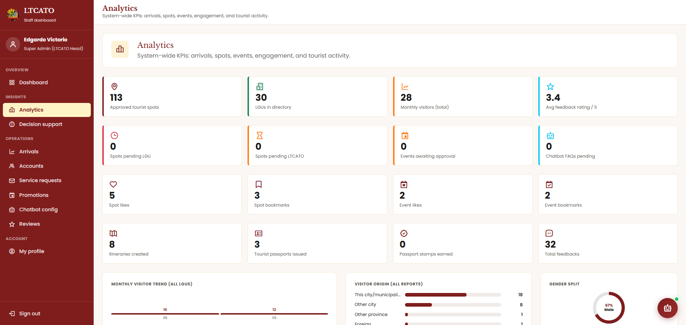

<div align="center">

# 🏛️ LagunaGuide
### An Integrated Web-Based Tourism Promotion, Tourist Monitoring, and Decision Support System with NLP-Based Multi-Stakeholder Chatbots for LTCATO

[](https://lspu.edu.ph/)
[](https://new-ltcato.vercel.app/)
[-1b6d39?style=for-the-badge&logo=checkmarx&logoColor=white)](#-empirical-evaluation--results-chapter-iv)
[](#-black-box-system-testing-table-2)
[](https://new-ltcato.vercel.app/)

<p align="center">
  <b>A Capstone Project presented to the Faculty of the College of Computer Studies</b><br>
  <b>Laguna State Polytechnic University – Santa Cruz Main Campus, Santa Cruz, Laguna</b><br>
  <i>In fulfillment of the requirements for the degree of Bachelor of Science in Information Technology</i>
</p>

[🌐 Live Production Platform](https://new-ltcato.vercel.app/) • [💻 Source Repository](https://github.com/LTCATO/ltacato-revamp) • [📄 Full Capstone Manuscript (PDF)](https://drive.google.com/file/d/1EINSy5REHtRd4Wc80K7U2DSOgbZMO-3i/view?usp=sharing) • [🎥 Video Demonstration](https://drive.google.com/file/d/1Uy9GlWVHqmr9lGYNR9UC6xep5RrxFOEV/view?usp=sharing)

---

</div>

## 📑 Table of Contents
- [Executive Abstract](#-executive-abstract)
- [Research Background & Problem Statement](#-research-background--problem-statement)
- [Project Objectives](#-project-objectives)
- [System Architecture (3-Tier)](#-system-architecture-3-tier)
- [Research Methodology (Chapter III)](#-research-methodology-chapter-iii)
  - [Research Design & 4-Phase Progression](#1-research-design--4-phase-progression)
  - [Agile Software Development Model (SDLC)](#2-agile-software-development-model-sdlc)
  - [Black-Box System Testing (Table 2)](#3-black-box-system-testing-table-2)
  - [Study Population & Sampling Design (Table 3)](#4-study-population--sampling-design-table-3)
- [Core System Modules & Live Interfaces](#-core-system-modules--live-interfaces)
- [Empirical Evaluation & Results (Chapter IV)](#-empirical-evaluation--results-chapter-iv)
- [Research Team & Academic Credentials](#-research-team--academic-credentials)
- [Citation (APA 7th Edition)](#-citation-apa-7th-edition)

---

## 📖 Executive Abstract

The **Laguna Tourism, Culture, Arts and Trade Office (LTCATO)** oversees tourism governance across the **30 Local Government Units (6 Cities and 24 Municipalities)** comprising the Province of Laguna, Philippines. Prior to this research, provincial tourism operations were constrained by three interconnected challenges: scattered and unverified promotional media, manual and delayed paper-based tourist arrival reporting submitted by Municipal Tourism Offices (MTOs), and the absence of data-driven sentiment analysis to guide provincial resource distribution.

**LagunaGuide** is an integrated web-based provincial digital platform designed to resolve these bottlenecks. Engineered through a descriptive-developmental research design and iterative Agile Software Development (ASD) sprints, the system delivers:
1. A **Centralized Geospatial Portal** indexing 150+ verified attractions, heritage landmarks, and DOT-accredited accommodations across all 4 legislative districts.
2. A **Standardized MTO Arrival Ingestion Engine** replacing physical paper consolidation with real-time monthly submission and automated Department of Tourism (DOT) reporting.
3. A **Multi-Stakeholder NLP Chatbot (LARA)** providing context-aware guidance for tourists and administrative procedural assistance for municipal tourism officers.
4. A **Decision Support System (DSS)** incorporating **VADER sentiment analysis** on visitor feedback alongside predictive seasonal arrival forecasting.

Empirical evaluation based on the international **ISO/IEC 25010 Software Quality Standard** across **204 validated respondents** yielded an overall grand mean rating of **4.08 / 5.00 ("Acceptable")**, supported by a **100% functional pass rate** during Black-Box system testing by 10 professional IT evaluators.

---

## 🔍 Research Background & Problem Statement

Laguna possesses an exceptional concentration of eco-tourism destinations, volcanic crater lakes, cascading waterfalls, ancestral woodcarving hubs, and historical shrines. However, field investigation and interviews conducted at LTCATO identified critical systemic deficits:

| Operational Dimension | Prior Status (Manual / Fragmented) | LagunaGuide Solution |
| :--- | :--- | :--- |
| **Tourism Information** | Dispersed across disconnected municipal social media pages with unverified hours, rates, and locations. | Centralized, georeferenced directory with 360° previews and 30-LGU filtering. |
| **Tourist Arrival Data** | Physical logbooks mailed or submitted via inconsistent spreadsheets, causing 2–3 month reporting lags to DOT. | Automated digital ingestion module with CSV batch intake, audit tracking, and instantaneous consolidation. |
| **Inquiry Handling** | Manual phone calls, emails, and office visits during business hours only. | 24/7 **LARA NLP Chatbot** parsing Taglish & English natural language inquiries for tourists and LGU officers. |
| **Itinerary Planning** | Generic or non-existent, often leading tourists to inefficient backtracking across districts. | Algorithmic circuit optimizer balancing budget, travel proximity, and open hours across Laguna's 4 districts. |
| **Provincial Decision Support** | Reactive policy-making without aggregated sentiment or predictive capacity warnings. | VADER NLP sentiment extraction triage + seasonal arrival surge modeling for executive planners. |

---

## 🎯 Project Objectives

As documented in Chapter I of the Capstone Manuscript, the study accomplished four specific objectives:

- [x] **Objective 1:** Design and develop a web-based promotional platform and algorithmic smart itinerary generator showcasing verified spots, cultural heritage, and local accommodations across all 30 Laguna LGUs.
- [x] **Objective 2:** Construct an automated arrival data ingestion and reporting pipeline for Municipal Tourism Officers (MTOs) and accommodation operators, facilitating real-time provincial data consolidation.
- [x] **Objective 3:** Implement LARA (Laguna Automated Recommendation Assistant), a multi-stakeholder NLP conversational engine, alongside a Decision Support System (DSS) with VADER review sentiment analysis.
- [x] **Objective 4:** Empirically evaluate the software quality of the developed platform across 9 characteristics of the ISO/IEC 25010 model and conduct functional Black-Box testing with technical evaluators.

---

## 🏗️ System Architecture (3-Tier)

LagunaGuide is engineered upon a high-performance **3-Tier Web Architecture**, ensuring security, modular scalability, and seamless separation of concerns:



---

## 🔬 Research Methodology (Chapter III)

### 1. Research Design & 4-Phase Progression
The study applied a **Descriptive-Developmental Research Methodology**:



---

### 2. Agile Software Development Model (SDLC)
Following **Adaptive Software Development (ASD)**, the system was implemented in 6 structured sprint iterations:

| Sprint Phase | Operational Focus | Deliverables Produced |
| :---: | :--- | :--- |
| **Phase 1: Planning** | Requirement elicitation with LTCATO leadership and MTO officers. | System Requirement Specifications (SRS), Use Case Diagrams, Scope Charter. |
| **Phase 2: Design** | Architectural structuring, entity-relationship modeling, wireframing. | ERD Schemas, 3-Tier Architecture Specifications, High-Fidelity UI Layouts. |
| **Phase 3: Development** | Sprint coding of backend APIs, frontend GIS modules, and NLP pipelines. | Flask RESTful Endpoints, Leaflet Map Ingestion, LARA Conversational Intents. |
| **Phase 4: Testing** | Unit testing, integration runs, and comprehensive black-box test execution. | System Testing Plan, Test Cases Matrix, Defect Verification Logs. |
| **Phase 5: Deployment** | Production staging, environment configuration, database seeding. | Vercel Serverless Hosting, Supabase Cloud PostgreSQL, SSL Security. |
| **Phase 6: Maintenance** | Continuous audit tracking, arrival database archiving, regulatory revisions. | Backup Routines, DOT Template Updates, Performance Logging. |

---

### 3. Black-Box System Testing (Table 2)
Technical functionality was validated through rigorous Black-Box testing conducted by **10 industry-qualified IT specialists**:

| Evaluator Name | Educational Background | Current Technical Position | Industry Experience | Result |
| :--- | :--- | :--- | :---: | :---: |
| **Elchier Santos Lontoc** | BS Computer Science, Colegio De San Lorenzo | Chief Technology Officer | 7 Years | **PASS** |
| **Ferdinand T. Celis** | BS Information Technology, LSPU Main Campus | Website Developer | 6 Years | **PASS** |
| **Mike Angelo Matrido** | BS Information Technology, AMA Computer Univ. | Information Security Officer | 13 Years | **PASS** |
| **Roswell James Vitaliz** | BS Information Technology, LSPU Main Campus | IT Specialist - Cybersecurity | 5 Years | **PASS** |
| **Christine Nicole Valdellon** | BS Information Technology, LSPU Main Campus | Junior Flutter Engineer | 5 Years | **PASS** |
| **Jovert A. Lobinia** | BS Information Technology, LSPU Main Campus | Technical Support Specialist | 5 Years | **PASS** |
| **Raina Gemanel** | BS Information Technology, LSPU Siniloan | Web Developer | 4 Years | **PASS** |
| **Jomari S. Borje** | BS Information Technology, LSPU Main Campus | IT Instructor | 2 Years | **PASS** |
| **Juliemar Añonuevo** | BS Information Technology, LSPU Main Campus | Marketing & Tech Strategist | 3 Years | **PASS** |
| **John Lloyd E. Ramos** | BS Information Technology, LSPU Main Campus | Software Developer | 4 Years | **PASS** |
| <strong colspan="4">Overall Black-Box Functional Verification Result</strong> | | **100% Pass** |

---

### 4. Study Population & Sampling Design (Table 3)
A **mixed sampling design** was executed across 204 stakeholders. Total enumeration was utilized for administrative groups (LTCATO and MTO staff), while stratified random sampling using **Slovin's Formula** (7% margin of error) was applied to tourists and establishment owners:

$$\text{Slovin's Formula: } n = \frac{N}{1 + N(e)^2}$$

| Stakeholder Category | Sampling Method | Sample Size ($n$) | Percentage Contribution |
| :--- | :---: | :---: | :---: |
| **Public Tourists (Local & Foreign)** | Stratified Random Sampling | 92 | 45.10% |
| **Municipal Tourism Office (MTO) Staff** | Total Enumeration | 90 | 44.12% |
| **LTCATO Provincial Staff** | Total Enumeration | 15 | 7.35% |
| **Establishment Owners / Managers** | Stratified Random Sampling | 6 | 2.94% |
| **LTCATO System Administrator** | Total Enumeration | 1 | 0.49% |
| **Total Evaluation Sample** | — | **204** | **100.00%** |

---

## 🖥️ Core System Modules & Live Interfaces

All screenshots reflect the live production system deployed at [new-ltcato.vercel.app](https://new-ltcato.vercel.app/):

### 1. Public Attraction Explorer & Interactive Map
Geospatial discovery catalog indexing 150+ verified attractions with 30-LGU filtering, 360° panoramas, and category tagging.


### 2. LARA Multi-Stakeholder NLP Chatbot
Context-aware conversational assistant delivering spot recommendations to tourists and regulatory reporting guidance to MTO staff.


### 3. Algorithmic Smart Itinerary Planner
Optimization engine factoring in budget limits, proximity clustering, and open hours across Laguna's legislative districts.


### 4. MTO Tourist Arrival Ingestion Module
Standardized arrival logging module replacing paper logbooks across 30 LGUs for Department of Tourism (DOT) compliance.


### 5. Decision Support System & VADER Review Sentiment
NLP sentiment classifier triaging visitor feedback alongside predictive seasonal arrival surge modeling.


### 6. LTCATO Provincial Executive Analytics Command Center
Executive monitoring screen tracking 30-LGU compliance, 1.48M+ annual arrivals, and DOT consolidated exports.


---

## 📊 Empirical Evaluation & Results (Chapter IV)

### ISO/IEC 25010 Software Quality Ratings (N = 204)
Evaluated using a 5-point Likert scale instrument across all 9 quality characteristics:

| Characteristic | Weighted Mean Score | Verbal Interpretation |
| :--- | :---: | :---: |
| **1. Reliability** | **4.13 / 5.00** | Acceptable / Highly Satisfactory |
| **2. Flexibility** | **4.11 / 5.00** | Acceptable / Highly Satisfactory |
| **3. Compatibility** | **4.09 / 5.00** | Acceptable / Highly Satisfactory |
| **4. Safety** | **4.09 / 5.00** | Acceptable / Highly Satisfactory |
| **5. Security** | **4.08 / 5.00** | Acceptable / Highly Satisfactory |
| **6. Maintainability** | **4.08 / 5.00** | Acceptable / Highly Satisfactory |
| **7. Performance Efficiency** | **4.07 / 5.00** | Acceptable / Highly Satisfactory |
| **8. Functional Suitability** | **4.06 / 5.00** | Acceptable / Highly Satisfactory |
| **9. Usability** | **4.05 / 5.00** | Acceptable / Highly Satisfactory |
| <strong colspan="2">Overall Grand Mean Rating</strong> | **4.08 / 5.00 ("Acceptable")** |

> **Academic Interpretation:** An overall grand mean of **4.08** demonstrates that LagunaGuide satisfies the operational, security, and functional standards required for provincial government deployment by LTCATO and the Department of Tourism.

---

## 👥 Research Team & Academic Credentials

### Authors & Student Researchers
- **Kyle Sam B. Camunias** — Lead Researcher (`camuniaskylesam97@gmail.com` • Kalayaan, Laguna)
- **Lawrence T. Celis** — Lead Researcher (`oyencelis@gmail.com` • Famy, Laguna)
- **Michelle A. Francia** — Lead Researcher (`michfrancia23@gmail.com` • Majayjay, Laguna)

### Capstone Thesis Adviser
- **Dr. Mia V. Villarica, DIT** — Associate Dean, College of Computer Studies, Laguna State Polytechnic University – Santa Cruz Main Campus

### Institutional Client Partner
- **Laguna Tourism, Culture, Arts and Trade Office (LTCATO)**
  - Provincial Capitol Complex, Santa Cruz, Laguna, Philippines
  - **Edgardo "Egay" Victorio**, Officer-in-Charge
  - **Arnold Pany**, Tourist Arrival Monitoring Unit

### Oral Defense Examination Panel
- **Mark P. Bernardino, MSCS**
- **Gener F. Mosico, MSIT**
- **Dr. Reynalen C. Justo, LPT, DIT**
- **Ma. Cezanne D. Dimaculangan, MA**
- **Dr. Rosario G. Catapang, PhD**
- *Oral Defense Committee Evaluation Ratings: 96%, 90%, 85%, 95%*

---

## 📚 Citation (APA 7th Edition)

If you reference this system, methodology, or dataset in academic research, please cite:

```bibtex
@mastersthesis{lagunaguide2026,
  title        = {{LagunaGuide: An Integrated Web-Based Tourism Promotion, Tourist Monitoring, and Decision Support System with NLP-Based Multi-Stakeholder Chatbots for LTCATO}},
  author       = {Camunias, Kyle Sam B. and Celis, Lawrence T. and Francia, Michelle A.},
  year         = {2026},
  month        = {October},
  school       = {Laguna State Polytechnic University, College of Computer Studies},
  address      = {Santa Cruz, Laguna, Philippines},
  type         = {Undergraduate Capstone Project}
}
```

**APA Citation Format:**
> Camunias, K. S. B., Celis, L. T., & Francia, M. A. (2026). *LagunaGuide: An integrated web-based tourism promotion, tourist monitoring, and decision support system with NLP-based multi-stakeholder chatbots for LTCATO* (Undergraduate Capstone Project, Laguna State Polytechnic University). Santa Cruz, Laguna, Philippines.

---

<div align="center">
  <p><b>Laguna State Polytechnic University &bull; College of Computer Studies &bull; LTCATO Provincial Government</b></p>
  <p>&copy; 2026 LagunaGuide Capstone Research Team. All rights reserved.</p>
</div>